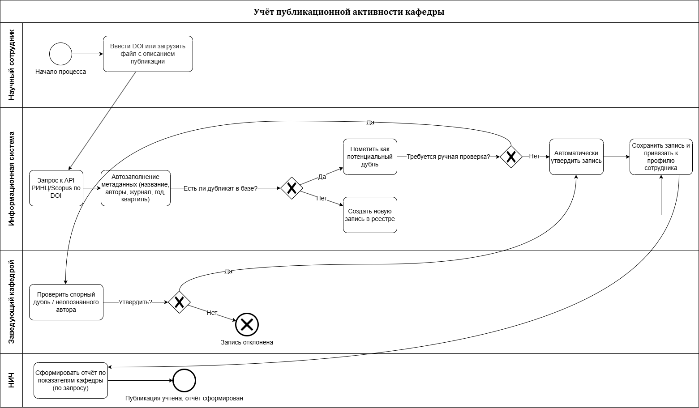

# Information-systems-design

## 4. Сравнение вариантов и обоснование выбора

### 4.1. Критерии и веса

Для сравнения трёх вариантов концепции выбраны шесть критериев, отражающих специфику учёта публикационной активности кафедры.

| № | Критерий | Вес $w_j$ | Обоснование веса |
|---|---|---|---|
| 1 | Покрытие функциональных требований (импорт РИНЦ/Scopus, отчёты) | 0,25 | Ключевая цель системы — автоматизировать сбор и отчётность |
| 2 | Качество работы с дублями и сопоставление ФИО авторов | 0,15 | Главная «боль» текущего процесса (AS-IS) |
| 3 | Стоимость владения за 3 года (TCO) | 0,20 | Ограниченный бюджет кафедры |
| 4 | Срок ввода в эксплуатацию | 0,10 | Не критичен, но важен для отчётных периодов |
| 5 | Безопасность и соответствие 152-ФЗ | 0,15 | Обрабатываются персональные данные сотрудников |
| 6 | Масштабируемость и возможность интеграции | 0,15 | Рост числа публикаций и связь с системами вуза |
| | **Сумма** | **1,00** | |

### 4.2. Таблица взвешенных оценок

Оценки вариантов по шкале от 1 (минимум) до 5 (максимум):

| Критерий | Вес $w_j$ | Вариант A (таблицы) | Вариант B (готовая система) | Вариант C (собственная разработка) |
|---|---|---|---|---|
| Покрытие функциональных требований | 0,25 | 2 | 4 | 5 |
| Качество работы с дублями и ФИО | 0,15 | 1 | 3 | 5 |
| Стоимость владения за 3 года | 0,20 | 5 | 3 | 3 |
| Срок ввода в эксплуатацию | 0,10 | 5 | 4 | 2 |
| Безопасность и соответствие 152-ФЗ | 0,15 | 2 | 4 | 4 |
| Масштабируемость и интеграция | 0,15 | 1 | 3 | 5 |
| **Итоговая оценка $S_i$** | **1,00** | **2,60** | **3,50** | **4,15** |

**Расчёт для варианта C:**

$$S_C = 0{,}25 \cdot 5 + 0{,}15 \cdot 5 + 0{,}20 \cdot 3 + 0{,}10 \cdot 2 + 0{,}15 \cdot 4 + 0{,}15 \cdot 5 = 1{,}25 + 0{,}75 + 0{,}60 + 0{,}20 + 0{,}60 + 0{,}75 = 4{,}15$$

**Расчёт для варианта B:**

$$S_B = 0{,}25 \cdot 4 + 0{,}15 \cdot 3 + 0{,}20 \cdot 3 + 0{,}10 \cdot 4 + 0{,}15 \cdot 4 + 0{,}15 \cdot 3 = 1{,}00 + 0{,}45 + 0{,}60 + 0{,}40 + 0{,}60 + 0{,}45 = 3{,}50$$

**Расчёт для варианта A:**

$$S_A = 0{,}25 \cdot 2 + 0{,}15 \cdot 1 + 0{,}20 \cdot 5 + 0{,}10 \cdot 5 + 0{,}15 \cdot 2 + 0{,}15 \cdot 1 = 0{,}50 + 0{,}15 + 1{,}00 + 0{,}50 + 0{,}30 + 0{,}15 = 2{,}60$$

### 4.3. Проверка устойчивости выбора

Для проверки устойчивости снизим вес наиболее значимого критерия «Покрытие функциональных требований» с 0,25 до 0,20, а освободившиеся 0,05 передадим критерию «Срок ввода в эксплуатацию» (станет 0,15).

| Вариант | Новая оценка |
|---|---|
| A | $0{,}20 \cdot 2 + 0{,}15 \cdot 1 + 0{,}20 \cdot 5 + 0{,}15 \cdot 5 + 0{,}15 \cdot 2 + 0{,}15 \cdot 1 = 2{,}75$ |
| B | $0{,}20 \cdot 4 + 0{,}15 \cdot 3 + 0{,}20 \cdot 3 + 0{,}15 \cdot 4 + 0{,}15 \cdot 4 + 0{,}15 \cdot 3 = 3{,}50$ |
| C | $0{,}20 \cdot 5 + 0{,}15 \cdot 5 + 0{,}20 \cdot 3 + 0{,}15 \cdot 2 + 0{,}15 \cdot 4 + 0{,}15 \cdot 5 = 4{,}00$ |

**Вывод:** Вариант C сохраняет лидерство (4,00 против 3,50 у B). Выбор устойчив к изменению весов критериев.

### 4.4. Матрица соответствия требований

| Требование | Тип | A | B | C |
|---|---|---|---|---|
| Импорт данных из РИНЦ | Must | Частично (файлы) | Зависит от продукта | Да (API) |
| Импорт данных из Scopus | Must | Частично (файлы) | Зависит от продукта | Да (API) |
| Выявление дубликатов публикаций | Must | Нет (ручные фильтры) | Частично | Да (алгоритм) |
| Сопоставление авторов (ФИО) | Must |  Нет | Частично | Да (алгоритм) |
| Формирование отчётов по показателям | Must | Да (сводные таблицы) | Да | Да |
| Веб-интерфейс для сотрудников | Should | Нет | Да | Да |
| Соответствие 152-ФЗ | Must | Нет (Excel) | Да | Да |
| Интеграция с ССО вуза | Should | Нет | Зависит | Да |

Вариант A не закрывает несколько обязательных требований (Must) и исключается из дальнейшего рассмотрения. Вариант B закрывает требования с оговорками, зависящими от конкретного продукта. **Вариант C полностью закрывает все требования**, включая обязательные.

### 4.5. Обоснование выбора

По результатам многокритериальной оценки выбран **Вариант C — собственная разработка веб-приложения**. Несмотря на более высокую первоначальную стоимость и длительные сроки разработки, этот вариант обеспечивает:
- полное покрытие функциональных требований, включая автоматический импорт из РИНЦ и Scopus;
- реализацию собственных алгоритмов выявления дубликатов и сопоставления авторов, что критично для кафедры;
- независимость от вендора и возможность гибкой адаптации под изменяющиеся требования отчётности;
- соответствие требованиям безопасности и интеграцию с инфраструктурой вуза.

---

## 5. Описание выбранной концепции и модель процессов TO-BE

### 5.1. Краткое описание выбранного варианта

**Вариант C — специализированное веб-приложение для учёта публикационной активности кафедры.**

**Идея решения:** единая веб-платформа с автоматическим импортом метаданных публикаций по DOI из внешних источников (РИНЦ, Scopus), встроенными механизмами выявления дубликатов и сопоставления авторов, а также модулем формирования отчётов для НИЧ.

**Автоматизируемые функции:**
- регистрация и ведение реестра публикаций сотрудников кафедры;
- автоматический импорт библиографических данных по DOI через API РИНЦ и Scopus;
- выявление дубликатов и сопоставление публикаций с сотрудниками по идентификаторам (Author ID, ORCID) и эвристическим правилам;
- формирование сводных отчётов по показателям эффективности (число публикаций, квартили, индекс Хирша);
- разграничение ролей: научный сотрудник, заведующий кафедрой, сотрудник НИЧ.

**Архитектура и технологии:**
- Backend: Python (FastAPI), REST API;
- Frontend: веб-интерфейс на React/Vue.js;
- База данных: PostgreSQL;
- Интеграции: API РИНЦ (eLIBRARY), Scopus API, система единой учётной записи вуза (SSO);
- Размещение: серверы вуза (требование по 152-ФЗ).

**Ресурсы (из Раздела 3):** команда 4–5 человек, трудоёмкость 6–10 чел.-мес., стоимость создания 400–800 тыс. руб., эксплуатация 50–120 тыс. руб./год, срок внедрения 4–6 месяцев.

### 5.2. Модель процесса TO-BE (BPMN)

Целевой процесс «Учёт публикации сотрудника кафедры» после внедрения ИС.

 

Процесс включает четыре участника (дорожки): научный сотрудник инициирует добавление публикации, информационная система автоматически загружает метаданные из РИНЦ/Scopus и выявляет дубликаты, заведующий кафедрой проверяет спорные случаи, НИЧ формирует отчёты по запросу. Границы системы показаны на диаграмме: автоматизированы импорт данных, поиск дубликатов и формирование отчётов; вручную остаются инициация процесса и экспертная проверка спорных дублей.

### 5.3. Связь с проблемами AS-IS

Внедрение выбранного варианта устраняет следующие проблемы текущего процесса (AS-IS):

| Проблема AS-IS | Как устраняется в TO-BE |
|---|---|
| Ручной ввод метаданных публикаций (название, авторы, журнал) | Автоматическое заполнение по DOI через API РИНЦ/Scopus |
| Дубликаты из-за разночтений в написании ФИО авторов | Алгоритм сопоставления по Author ID, ORCID и эвристикам |
| Долгое формирование отчётов для НИЧ (вручную, в конце года) | Автоматическое формирование отчётов по запросу в реальном времени |
| Потеря публикаций при смене сотрудников | Централизованный реестр, привязанный к учётной записи вуза |

### 5.4. Границы системы

**Автоматизируется ИС:**
- импорт метаданных из внешних источников;
- поиск и пометка дубликатов;
- формирование отчётов;
- разграничение доступа по ролям.

**Остаётся ручным:**
- первичная инициация процесса (сотрудник вводит DOI или загружает файл);
- ручная проверка спорных дубликатов и неопознанных авторов заведующим кафедрой (экспертное решение).